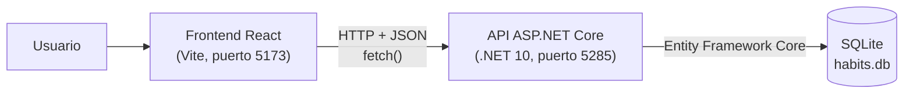
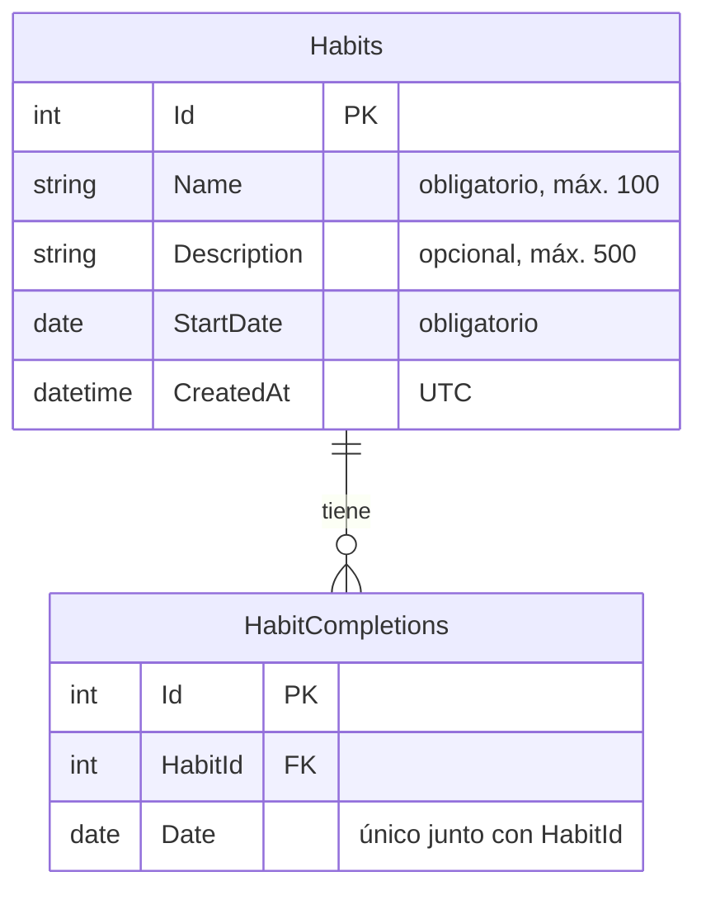
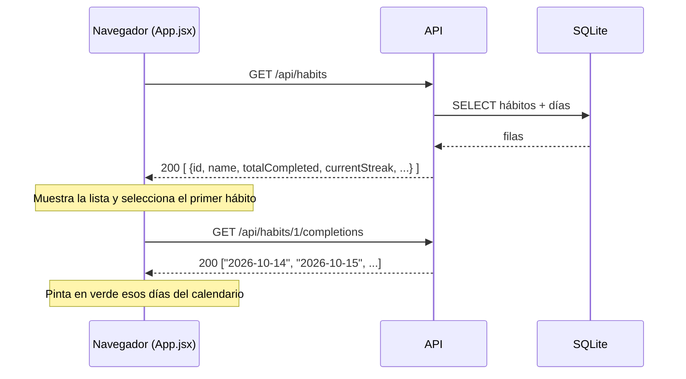
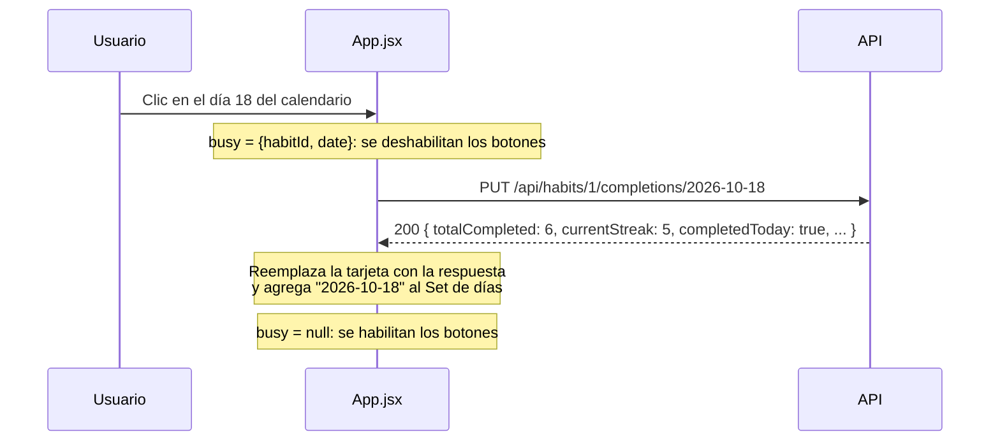

# Documentación técnica: cómo está hecha la API y cómo la consume el frontend

Este documento explica cómo está construida la API REST en .NET 10 y cómo el frontend en React la usa.
Para instalar y ejecutar el proyecto, ver el [README](README.md).

---

## 1. Visión general



- El **frontend** solo muestra la información y envía lo que hace el usuario (crear, editar, marcar un día...). No guarda datos propios.
- La **API** tiene toda la lógica: valida los datos, calcula el progreso (total de días y racha) y lee y escribe en la base de datos.
- La **base de datos** es un archivo SQLite (`habits.db`) que se crea solo la primera vez que arranca la API.

---

## 2. La API (`HabitTrackerApi/`)

### 2.1 Creación del proyecto

El proyecto parte de la plantilla **ASP.NET Core Web API con controladores** y luego se cambió a `net10.0`.
Desde la terminal, lo equivalente sería:

```bash
dotnet new webapi --use-controllers -n HabitTrackerApi -f net10.0
```

Paquetes NuGet que se agregaron:

| Paquete | Versión | Para qué |
|---|---|---|
| `Microsoft.EntityFrameworkCore.Sqlite` | 10.0.13 | Usar SQLite con Entity Framework Core |
| `Microsoft.EntityFrameworkCore.Design` | 10.0.13 | Crear migraciones con `dotnet ef` |
| `Microsoft.AspNetCore.OpenApi` | 10.0.13 | Generar la descripción OpenAPI de la API (viene en la plantilla) |
| `Swashbuckle.AspNetCore.SwaggerUI` | 10.3.0 | Página de Swagger para probar los endpoints |

```bash
dotnet add package Microsoft.EntityFrameworkCore.Sqlite --version 10.0.13
dotnet add package Microsoft.EntityFrameworkCore.Design --version 10.0.13
dotnet add package Swashbuckle.AspNetCore.SwaggerUI --version 10.3.0
```

### 2.2 Estructura de carpetas

```
HabitTrackerApi/
├── Controllers/
│   └── HabitsController.cs     Endpoints REST y validaciones de negocio
├── Data/
│   └── AppDbContext.cs         Contexto de EF Core: tablas, relación e índices
├── Dtos/
│   └── HabitDtos.cs            Datos que entran (request) y que salen (response)
├── Models/
│   ├── Habit.cs                Entidad hábito
│   └── HabitCompletion.cs      Entidad día cumplido
├── Services/
│   └── StreakCalculator.cs     Cálculo de la racha actual
├── Migrations/                 Migraciones generadas por EF Core
├── Program.cs                  Configuración y arranque de la aplicación
├── appsettings.json            Cadena de conexión y orígenes permitidos (CORS)
└── HabitTrackerApi.http        Peticiones de ejemplo
```

La idea es separar responsabilidades: los **modelos** representan las tablas, los **DTOs** son lo que viaja por HTTP,
el **controlador** recibe las peticiones y el **DbContext** habla con la base de datos.

### 2.3 Modelo de datos

Hay dos tablas: un hábito tiene muchos días cumplidos.



**`Models/Habit.cs`**

```csharp
public class Habit
{
    public int Id { get; set; }
    public string Name { get; set; } = string.Empty;
    public string? Description { get; set; }
    public DateOnly StartDate { get; set; }
    public DateTime CreatedAt { get; set; }

    public List<HabitCompletion> Completions { get; set; } = new();
}
```

**`Models/HabitCompletion.cs`**: cada fila significa "este hábito se cumplió este día". Desmarcar un día es borrar su fila.

```csharp
public class HabitCompletion
{
    public int Id { get; set; }
    public int HabitId { get; set; }
    public DateOnly Date { get; set; }

    public Habit? Habit { get; set; }
}
```

Se usa `DateOnly` (solo fecha, sin hora) porque un día cumplido no tiene hora. En JSON viaja como `"2026-10-18"`.

### 2.4 `AppDbContext`

En `Data/AppDbContext.cs` se configuran las reglas que la base de datos hace cumplir por sí misma:

```csharp
modelBuilder.Entity<HabitCompletion>(e =>
{
    // Un mismo día no se puede marcar dos veces para el mismo hábito.
    e.HasIndex(c => new { c.HabitId, c.Date }).IsUnique();

    // Al eliminar un hábito se eliminan también sus días cumplidos.
    e.HasOne(c => c.Habit)
     .WithMany(h => h.Completions)
     .HasForeignKey(c => c.HabitId)
     .OnDelete(DeleteBehavior.Cascade);
});
```

- **Índice único `(HabitId, Date)`**: aunque lleguen dos peticiones iguales al mismo tiempo, en la base no puede haber dos filas para el mismo día.
- **Borrado en cascada**: al eliminar un hábito no quedan días "huérfanos" en la tabla.
- `Name` es obligatorio con un máximo de 100 caracteres, y `Description` tiene un máximo de 500.

### 2.5 `Program.cs`: configuración y arranque

```csharp
builder.Services.AddControllers();
builder.Services.AddOpenApi();
builder.Services.AddProblemDetails();

builder.Services.AddDbContext<AppDbContext>(options =>
    options.UseSqlite(builder.Configuration.GetConnectionString("DefaultConnection")));
```

Qué hace cada parte:

1. **Controladores**: registra `HabitsController`.
2. **ProblemDetails**: todos los errores, incluso los inesperados (500), se devuelven como JSON con un formato estándar y no como una página HTML.
3. **DbContext**: conecta EF Core con SQLite. La cadena viene de `appsettings.json`: `"Data Source=habits.db"`.
4. **CORS**: el frontend corre en otro puerto (5173), así que el navegador bloquearía las llamadas si la API no lo permitiera explícitamente. Los orígenes permitidos están en `appsettings.json`:

   ```json
   "AllowedOrigins": [ "http://localhost:5173", "http://127.0.0.1:5173" ]
   ```

5. **Migraciones automáticas**: al iniciar, la API crea la base si no existe y aplica las migraciones pendientes:

   ```csharp
   using (var scope = app.Services.CreateScope())
   {
       var db = scope.ServiceProvider.GetRequiredService<AppDbContext>();
       db.Database.Migrate();
   }
   ```

6. **Swagger** (solo en desarrollo): `http://localhost:5285/swagger` para probar los endpoints desde el navegador.

### 2.6 DTOs y validación automática

El controlador no recibe ni devuelve las entidades directamente, sino **DTOs** (`Dtos/HabitDtos.cs`).

**Entrada**: `HabitRequestDto`, que se usa al crear y al editar. Las validaciones simples se declaran con atributos:

```csharp
public class HabitRequestDto
{
    [Required(ErrorMessage = "El nombre es obligatorio.")]
    [StringLength(100, MinimumLength = 2, ErrorMessage = "El nombre debe tener entre 2 y 100 caracteres.")]
    public string Name { get; set; } = string.Empty;

    [StringLength(500, ErrorMessage = "La descripción no puede superar los 500 caracteres.")]
    public string? Description { get; set; }

    [Required(ErrorMessage = "La fecha de inicio es obligatoria.")]
    public DateOnly? StartDate { get; set; }
}
```

Como el controlador tiene `[ApiController]`, ASP.NET Core revisa estos atributos **antes** de entrar al método. Si algo
falla, responde `400` con los errores por campo y el código del método ni siquiera se ejecuta.

**Salida**: `HabitResponseDto`, que incluye el progreso ya calculado para que el frontend no tenga que calcular nada:

```csharp
public record HabitResponseDto(
    int Id, string Name, string? Description, DateOnly StartDate, DateTime CreatedAt,
    int TotalCompleted, int CurrentStreak, bool CompletedToday);
```

### 2.7 El controlador: `HabitsController`

Ruta base: `api/habits`. El `AppDbContext` llega por **inyección de dependencias** en el constructor.

| Método | Ruta | Qué hace | Respuestas |
|---|---|---|---|
| GET | `/api/habits` | Lista todos los hábitos con su progreso | 200 |
| GET | `/api/habits/{id}` | Un hábito | 200, 404 |
| POST | `/api/habits` | Crea un hábito | 201, 400 |
| PUT | `/api/habits/{id}` | Edita un hábito | 200, 400, 404 |
| DELETE | `/api/habits/{id}` | Elimina el hábito y sus días | 204, 404 |
| GET | `/api/habits/{id}/completions` | Lista de fechas cumplidas | 200, 404 |
| PUT | `/api/habits/{id}/completions/{fecha}` | Marca un día como cumplido | 200, 400, 404 |
| DELETE | `/api/habits/{id}/completions/{fecha}` | Desmarca un día | 200, 400, 404 |

Detalles de diseño:

- **Marcar un día usa `PUT` y es idempotente**: si el día ya estaba marcado, no da error y devuelve el mismo resultado. Así un doble clic no rompe nada.
- **Marcar y desmarcar devuelven el hábito actualizado** (con el nuevo total y la nueva racha). El frontend reemplaza la tarjeta con esa respuesta sin pedir la lista otra vez.
- **Las consultas de solo lectura usan `AsNoTracking()`**, que es más liviano porque EF Core no necesita seguir los cambios de esos objetos.

#### Validaciones de negocio (dentro del controlador)

Son las reglas que no se pueden expresar con atributos porque dependen de la base de datos o de otros datos:

| Regla | Dónde | Respuesta |
|---|---|---|
| El nombre, sin espacios al inicio y al final, tiene al menos 2 caracteres | `ValidateHabit` | 400, campo `Name` |
| No hay otro hábito con el mismo nombre (sin distinguir mayúsculas) | `ValidateHabit` | 400, campo `Name` |
| Al editar, la fecha de inicio no queda después del primer día ya marcado | `Update` | 400, campo `StartDate` |
| La fecha de la URL tiene formato `yyyy-MM-dd` y existe (por ejemplo, rechaza `2026-02-30`) | `TryParseDate` | 400 |
| Solo se marcan días entre la fecha de inicio y hoy | `ValidateDay` | 400 |
| El hábito existe | `HabitNotFound` | 404 |

La fecha de inicio puede ser cualquier fecha (pasada, hoy o futura). Si es futura, no se puede marcar ningún día hasta que llegue.

Ejemplo de cómo se agrega un error de negocio para que salga en el mismo formato que los de los atributos:

```csharp
ModelState.AddModelError(nameof(HabitRequestDto.Name), $"Ya existe un hábito llamado \"{name}\".");
// ...
if (!ModelState.IsValid) return ValidationProblem(ModelState);
```

### 2.8 Cálculo de la racha (`Services/StreakCalculator.cs`)

La racha actual es el número de días seguidos cumplidos que terminan hoy. Si hoy todavía no se marcó, se cuenta
hasta ayer (el día aún no termina, así que la racha no se pierde).

```csharp
var day = dates.Contains(today) ? today : today.AddDays(-1);
var streak = 0;
while (dates.Contains(day))
{
    streak++;
    day = day.AddDays(-1);
}
```

Ejemplo: días cumplidos 14, 15, 16 y 17, y hoy es 18 sin marcar → racha 4. Si se marca el 18 → racha 5.

### 2.9 Formato de las respuestas de error

Todos los errores siguen el estándar **ProblemDetails** (RFC 9110). Hay dos formas:

**Error de un campo del formulario** (validación): trae `errors`, con los mensajes de cada campo:

```json
{
  "title": "One or more validation errors occurred.",
  "status": 400,
  "errors": {
    "Name": ["Ya existe un hábito llamado \"Leer 20 minutos\"."]
  }
}
```

**Error general**: trae `detail` con el mensaje:

```json
{
  "title": "Fecha no válida",
  "status": 400,
  "detail": "No puedes marcar un día anterior a la fecha de inicio (2026-10-05)."
}
```

El frontend sabe leer las dos formas (ver la sección 3.4).

### 2.10 Migraciones

La base de datos se define con código (*code first*). La migración inicial se creó con:

```bash
dotnet ef migrations add InitialCreate
```

Esto generó la carpeta `Migrations/` con las instrucciones para crear las tablas, el índice único y la llave foránea con
cascada. No hace falta correr `dotnet ef database update` porque `Program.cs` aplica las migraciones al iniciar.

Si más adelante se cambia un modelo, se crea una migración nueva con `dotnet ef migrations add NombreDelCambio`.

---

## 3. El frontend (`frontend/`)

### 3.1 Creación del proyecto

```bash
npm create vite@latest frontend -- --template react
cd frontend
npm install
```

No usa librerías extra: React y `fetch` (que viene en el navegador) alcanzan para todo. El calendario está hecho a mano.

### 3.2 Estructura

```
frontend/src/
├── api/
│   └── habitsApi.js        Única capa que habla con la API
├── components/
│   ├── HabitForm.jsx       Formulario para crear y editar, con validaciones
│   ├── HabitCard.jsx       Tarjeta de un hábito en la lista
│   └── HabitCalendar.jsx   Calendario mensual para marcar días
├── utils/
│   └── dates.js            Manejo de fechas "yyyy-mm-dd"
├── App.jsx                 Pantalla principal: estado y coordinación
├── App.css / index.css     Estilos
└── main.jsx                Punto de entrada
```

### 3.3 Dirección de la API

Está en `src/api/habitsApi.js`:

```js
export const API_URL = (import.meta.env.VITE_API_URL || 'http://localhost:5285').replace(/\/$/, '')
```

Por defecto apunta a `http://localhost:5285`. Si la API corre en otra dirección, se crea `frontend/.env` (tomando como
base `.env.example`) con `VITE_API_URL=...`.

### 3.4 La capa de acceso a la API: `habitsApi.js`

**Ningún componente llama a `fetch` directamente.** Todo pasa por una función `request()`, así los errores se
manejan igual en toda la aplicación.

```js
async function request(path, { method = 'GET', body } = {}) {
  let response
  try {
    response = await fetch(`${API_URL}${path}`, {
      method,
      headers: body ? { 'Content-Type': 'application/json' } : undefined,
      body: body ? JSON.stringify(body) : undefined,
    })
  } catch {
    // fetch solo falla así cuando no hay conexión (la API está apagada, etc.)
    throw new ApiError(`No se pudo conectar con la API (${API_URL}). Verifica que esté en ejecución.`)
  }

  if (response.status === 204) return null          // DELETE exitoso, sin contenido
  const data = await response.json().catch(() => null)

  if (!response.ok) {
    // Convierte el ProblemDetails de la API en un ApiError con:
    //  - message: el "detail" o un mensaje general
    //  - fieldErrors: { name: '...', startDate: '...' } para mostrar bajo cada campo
    ...
    throw new ApiError(message, response.status, fieldErrors)
  }
  return data
}
```

Puntos importantes:

- **Sin conexión**: `fetch` lanza una excepción solo cuando no puede conectarse. Se convierte en un mensaje claro para el usuario.
- **Errores HTTP** (400, 404, 500): `fetch` **no** lanza excepción por sí solo, por eso se revisa `response.ok`.
- **Nombres de campos**: la API devuelve `"Name"` y `"StartDate"`, y se convierten a `name` y `startDate` para que coincidan con los campos del formulario.

Encima de `request()` hay un objeto con una función por endpoint:

```js
export const habitsApi = {
  getAll:         ()           => request('/api/habits'),
  create:         (habit)      => request('/api/habits', { method: 'POST', body: habit }),
  update:         (id, habit)  => request(`/api/habits/${id}`, { method: 'PUT', body: habit }),
  remove:         (id)         => request(`/api/habits/${id}`, { method: 'DELETE' }),
  getCompletions: (id)         => request(`/api/habits/${id}/completions`),
  markDay:        (id, date)   => request(`/api/habits/${id}/completions/${date}`, { method: 'PUT' }),
  unmarkDay:      (id, date)   => request(`/api/habits/${id}/completions/${date}`, { method: 'DELETE' }),
}
```

### 3.5 Estado de la aplicación (`App.jsx`)

`App.jsx` guarda el estado y se lo pasa a los componentes por *props*:

| Estado | Contenido |
|---|---|
| `habits` | Lista de hábitos tal como la devuelve la API (con total y racha) |
| `loading` / `loadError` | Si se está cargando la lista o si falló |
| `selectedId` | Hábito cuyo calendario se muestra |
| `editingId` | Hábito que se está editando (`null` = formulario de crear) |
| `completions` | Fechas cumplidas del hábito seleccionado, como un `Set` |
| `busy` | Hábito o día con una petición en curso (para deshabilitar botones) |
| `notice` | Mensaje de éxito o de error que se muestra arriba |

Los componentes (`HabitForm`, `HabitCard`, `HabitCalendar`) **no llaman a la API**: avisan a `App` con funciones
(`onSubmit`, `onToggleDay`, `onDelete`...) y `App` hace la llamada.

### 3.6 Flujos principales

#### Al abrir la página



Al cambiar de hábito se vuelven a pedir sus días. Si el usuario cambia rápido de un hábito a otro, una bandera
`ignore` descarta las respuestas viejas para que no se muestren los días de otro hábito.

#### Crear o editar un hábito

1. `HabitForm` valida en el navegador con **las mismas reglas que la API** (nombre de 2 a 100 caracteres, descripción hasta 500, fecha obligatoria). Si algo falla, muestra el error y no envía nada.
2. Si todo está bien, llama a `onSubmit` → `App` hace `POST /api/habits` o `PUT /api/habits/{id}`.
3. Si la API responde bien, se agrega o reemplaza el hábito en `habits` y aparece un mensaje de éxito.
4. Si la API lo rechaza (por ejemplo, por un nombre repetido, que solo la API puede saber), `App` devuelve los `fieldErrors` al formulario y el error aparece **debajo del campo correspondiente**.

#### Marcar o desmarcar un día



- Para desmarcar es igual, pero con `DELETE`.
- El botón "Marcar hoy" de la tarjeta usa esta misma función con la fecha de hoy.
- El total y la racha **los calcula la API**, y el frontend solo muestra lo que recibe.

#### Eliminar

Se pide confirmación con `window.confirm`, avisando cuántos días cumplidos se van a borrar. Después se llama a
`DELETE /api/habits/{id}`, se quita de la lista y se selecciona otro hábito.

### 3.7 Cómo se muestran los errores

| Situación | Qué ve el usuario |
|---|---|
| La API está apagada al abrir la página | Recuadro "No se pudo conectar con la API..." con botón **Reintentar** |
| Error en un campo del formulario | Mensaje en rojo bajo el campo y borde rojo |
| Cualquier otro error (404, fecha no válida...) | Aviso rojo arriba, que se queda hasta cerrarlo |
| Operación exitosa | Aviso verde arriba, que se oculta solo a los 3 segundos |

Además, si una operación falla, `App` vuelve a pedir la lista a la API (`loadHabits()`) para que la pantalla quede
igual a lo que de verdad hay en la base de datos.

### 3.8 Por qué las fechas se manejan como texto

Las fechas viajan como `"yyyy-mm-dd"`, el mismo formato que usa la API con `DateOnly`. En `utils/dates.js` la fecha
de hoy se arma con la hora **local**:

```js
export function todayIso() {
  const now = new Date()
  return toIsoDate(now.getFullYear(), now.getMonth(), now.getDate())
}
```

No se usa `new Date().toISOString()` porque convierte a UTC. Por ejemplo, a las 8 p. m. en una zona horaria UTC-5
ya es el día siguiente en UTC, y se marcaría el día equivocado.

Como el formato es `yyyy-mm-dd`, dos fechas se pueden comparar directamente como texto: `"2026-10-05" < "2026-10-18"`.
El calendario lo usa para saber qué días están antes de la fecha de inicio o después de hoy.

---

## 4. Resumen: cómo se conectan las dos partes

| Tema | API | Frontend |
|---|---|---|
| Dirección | `http://localhost:5285` | `API_URL` en `habitsApi.js` (o `VITE_API_URL`) |
| Permiso entre puertos | CORS permite `http://localhost:5173` | Corre en `http://localhost:5173` |
| Formato | JSON con nombres en camelCase (`startDate`) | Envía y recibe objetos JS con esos mismos nombres |
| Fechas | `DateOnly` ↔ `"2026-10-18"` | Texto `"yyyy-mm-dd"` en hora local |
| Validaciones | Todas, incluidas las que dependen de la base (nombre repetido) | Las mismas reglas simples, para avisar antes de enviar |
| Errores | ProblemDetails (`detail` o `errors`) | `ApiError` con `message` y `fieldErrors` |
| Progreso | Calcula `totalCompleted`, `currentStreak` y `completedToday` | Solo los muestra |

La regla general: **la API es la fuente de verdad**. Las validaciones del frontend son una ayuda para el usuario,
pero la API vuelve a validar todo, porque cualquiera podría llamarla directamente (con Swagger, curl o Postman) sin
pasar por el formulario.
